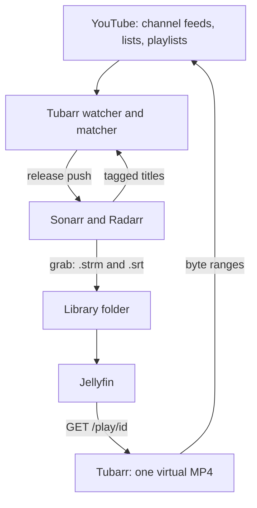

<p align="center">
  
  
</p>

<p align="center">
  YouTube as a source for Sonarr and Radarr, played in Jellyfin without storing the videos.
</p>

<p align="center">
  
  
  <a href="https://github.com/h1n054ur/tubarr/releases"></a>
  <a href="https://h1n054ur.github.io/tubarr/"></a>
</p>

## What it does

Tubarr makes YouTube a source for Sonarr and Radarr. To them it looks like an indexer and a download client. A grab writes a small `.strm` link file and the video's captions as `.srt`, Sonarr or Radarr import those like any episode or film, and Jellyfin plays the link.

At play time Tubarr looks up the YouTube stream and serves the video and audio joined into one MP4, without re-encoding, without ffmpeg and without storing the videos. It is meant for shows and films that official channels publish in full on YouTube, matched to the right episode by per-show rules. When a match is unclear it answers nothing and leaves a note instead.



Tubarr works with Jellyfin. It does not work with Plex, because Plex does not play `.strm` files. See [Which media servers work](https://h1n054ur.github.io/tubarr/setup/jellyfin/#which-media-servers-work). It is pre-alpha: it runs day to day, but config keys and APIs can still change between versions.

## Screenshots

These are from the demo data, which uses public channel names only.

<details>
<summary>Shows and films</summary>


Every series and film Tubarr serves, with release and unmatched counts. The search box and the Kind and Status filters narrow the list, and the Kind filter has a Podcasts choice.

</details>

<details>
<summary>Mapping drawer</summary>


The rules for one show: official channels, episode regex, excludes, minimum length, language and back episodes. "Test against channel" runs them over known videos and writes nothing.

</details>

<details>
<summary>Unmatched</summary>


What the matcher saw but did not release, with a reason for each (unsure, partial, duplicate). Pin settles one, Ignore hides it.

</details>

<details>
<summary>Drafts</summary>


Entries for titles that TheTVDB or TMDB do not have yet, drafted from what Tubarr knows about the official channel, ready to copy.

</details>

<details>
<summary>Activity</summary>


Grabs from Sonarr and Radarr with their status, plus searches, pushes and play starts further down the page. "Push released" is the catch-up.

</details>

<details>
<summary>Health</summary>


Lookup budget, canary, released and waiting counts, and the yt-dlp and deno versions with a check for updates and a rollback.

</details>

<details>
<summary>Settings</summary>


The Sonarr and Radarr connections: test and save, run the setup check, or see that a connection comes from the config file.

</details>

<details>
<summary>Shows on a phone</summary>


The same page on a phone: the table turns into a list and the menu moves behind the button.

</details>

## Quick start

Tubarr ships as a Docker image, `ghcr.io/h1n054ur/tubarr:0.1`. Make the folders (owned by uid 1000), write a config with your `public_url`, which is how Jellyfin reaches Tubarr, and start it:

```sh
mkdir -p config downloads && sudo chown 1000:1000 config downloads
echo 'public_url = "http://192.168.1.20:8480"' > config/tubarr.toml
docker run -d --name tubarr -p 8480:8480 \
  -v ./config:/config -v ./downloads:/downloads --memory 1g \
  ghcr.io/h1n054ur/tubarr:0.1
```

On the first start, while no user exists, Tubarr logs a one-time setup code. Open `http://<host>:8480/`, enter the code and make the first administrator. Sonarr and Radarr also need an `api_key_file` in the config. The [install page](https://h1n054ur.github.io/tubarr/getting-started/install/) has the full Compose file and the memory limit, and the [first run page](https://h1n054ur.github.io/tubarr/getting-started/first-run/) explains the setup code.

## Where it runs well

A home connection works best. On a VPS or cloud host YouTube often answers with a bot check, and the docs page [Where to run it](https://h1n054ur.github.io/tubarr/operations/where-to-run/) shows how to point Tubarr's YouTube traffic at a proxy or a VPN container.

## Docs

Full documentation is at [https://h1n054ur.github.io/tubarr/](https://h1n054ur.github.io/tubarr/).

- Getting started: [Install](https://h1n054ur.github.io/tubarr/getting-started/install/), [Quick start](https://h1n054ur.github.io/tubarr/getting-started/quick-start/), [First run](https://h1n054ur.github.io/tubarr/getting-started/first-run/)
- Setup: [Configuration](https://h1n054ur.github.io/tubarr/setup/configuration/), [Sonarr and Radarr](https://h1n054ur.github.io/tubarr/setup/sonarr-and-radarr/), [Jellyfin](https://h1n054ur.github.io/tubarr/setup/jellyfin/), [Prowlarr](https://h1n054ur.github.io/tubarr/setup/prowlarr/)
- Using Tubarr: [Mappings and matching](https://h1n054ur.github.io/tubarr/using/mappings-and-matching/), [Podcasts](https://h1n054ur.github.io/tubarr/using/podcasts/), [Pins and unmatched](https://h1n054ur.github.io/tubarr/using/pins-and-unmatched/)
- Operations: [Sizing](https://h1n054ur.github.io/tubarr/operations/sizing/), [Where to run it](https://h1n054ur.github.io/tubarr/operations/where-to-run/), [Backups and upgrades](https://h1n054ur.github.io/tubarr/operations/backups-and-upgrades/), [Monitoring](https://h1n054ur.github.io/tubarr/operations/monitoring/), [Troubleshooting](https://h1n054ur.github.io/tubarr/operations/troubleshooting/)
- Reference: [Admin API](https://h1n054ur.github.io/tubarr/reference/admin-api/)
- About: [FAQ](https://h1n054ur.github.io/tubarr/about/faq/), [Privacy](https://h1n054ur.github.io/tubarr/about/privacy/), [Terms](https://h1n054ur.github.io/tubarr/about/terms/)

## Terms and personal use

Tubarr is not affiliated with, endorsed by or connected to YouTube or Google.

Please read this before you run it. Tubarr reaches YouTube without YouTube's own player or apps. It looks videos up with yt-dlp, an automated client, reads the stream files and passes them on to your media server. YouTube's Terms of Service do not allow this. They rule out using automated means to reach the service, and they rule out downloading or passing on content unless YouTube offers a way to do it or has given written permission. Tubarr does not save the videos, but it still relays them, so running it goes against those terms.

Whoever runs an instance is responsible for following YouTube's terms and the law where they live. If you are not comfortable with that, please don't run it.

It is meant for personal use: one person or one household watching shows and films that official channels publish in full and free on YouTube. It is not meant for public instances, for serving people outside your home, or for anything commercial. Public instances are not supported.

The [terms page](https://h1n054ur.github.io/tubarr/about/terms/) also lists what it does not do (no DRM or paywall bypass, no Google account unless you give it one, no telemetry). This is not legal advice.

## Contributing, security and licence

- Contributing: see [CONTRIBUTING.md](CONTRIBUTING.md), which also covers building, the demo stack and the repo layout.
- Security reports: see [SECURITY.md](SECURITY.md).
- Licence: AGPL-3.0-only, see [LICENSE](LICENSE).
