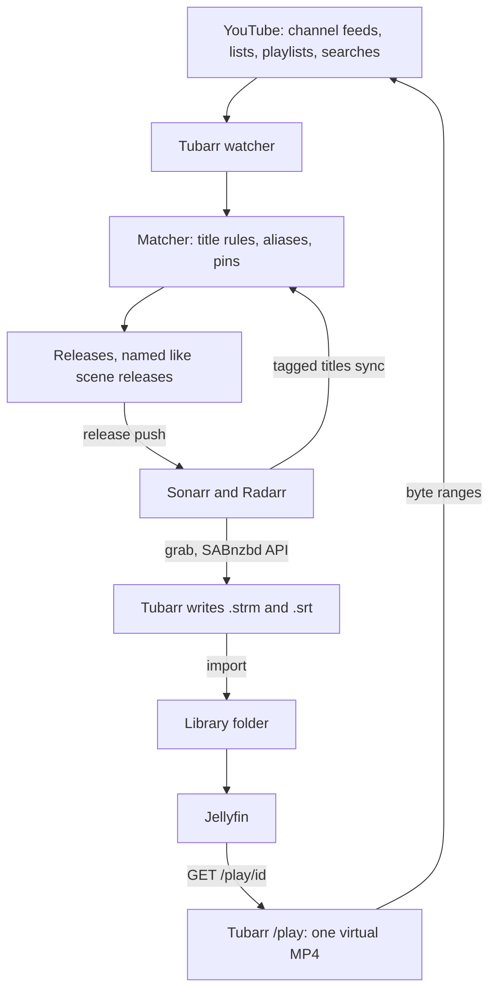
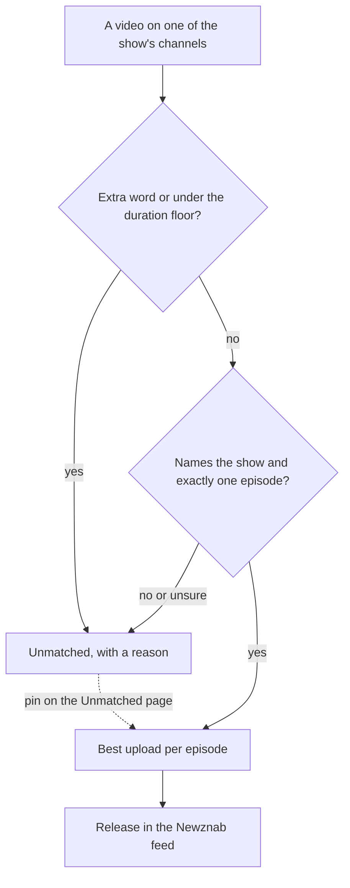
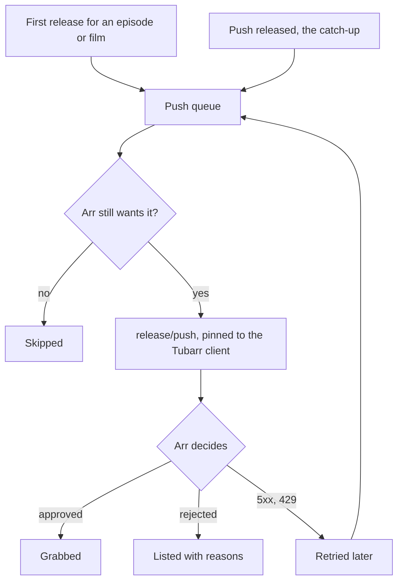

<p align="center">
  
  
</p>

<p align="center">
  YouTube as a source for Sonarr and Radarr, played in Jellyfin without storing the videos.
</p>

<p align="center">
  
  
  
</p>

Tubarr makes YouTube a source for Sonarr and Radarr. To them it looks like an indexer (the Newznab API) and a download client (a SABnzbd-style API). Instead of downloading anything, a grab writes a small `.strm` link file and the video's captions as `.srt`. Sonarr or Radarr import those like any episode or film, and Jellyfin plays the link. At play time Tubarr looks up the YouTube stream and serves the video and audio tracks joined into one MP4, without re-encoding, without ffmpeg and without storing the videos.

It is meant for shows and films that official channels publish in full on YouTube, matched to the right episode by per-show rules (official channels only, episode patterns, a duration floor, excludes for promos and highlights). When a match is unclear it answers nothing and leaves a note instead.

Tubarr works with Jellyfin. It does not work with Plex, because Plex does not play `.strm` files. Emby and Kodi play `.strm` files but have not been tried with Tubarr. See [Which media servers work](docs/src/content/docs/setup/jellyfin.md#which-media-servers-work).

## Status

Pre-alpha. It runs day to day: the watcher, the matcher, the Newznab and SABnzbd APIs, the release push to the arrs, `/play`, captions, sign-in and the web UI all work. Config keys and APIs can still change between versions.

## Terms and personal use

Tubarr is not affiliated with, endorsed by or connected to YouTube or Google.

Please read this before you run it. Tubarr reaches YouTube without YouTube's own player or apps. It looks videos up with yt-dlp, an automated client, reads the stream files and passes them on to your media server. YouTube's Terms of Service do not allow this. They rule out using automated means to reach the service, and they rule out downloading or passing on content unless YouTube offers a way to do it or has given written permission. Tubarr does not save the videos, but it still relays them, so running it goes against those terms.

Whoever runs an instance is responsible for following YouTube's terms and the law where they live. If you are not comfortable with that, please don't run it.

It is meant for personal use: one person or one household watching shows and films that official channels publish in full and free on YouTube. It is not meant for public instances, for serving people outside your home, or for anything commercial. Public instances are not supported.

What it does not do:

- It does not decrypt DRM or get around paywalls. It plays only the plain H.264 and AAC streams YouTube offers anyone.
- It skips videos for channel members or YouTube Premium only, and looks at them again later in case the channel opens them to everyone.
- It does not use a Google account unless you give it one. The optional cookies fallback signs lookups in with an account you supply. That account can be flagged or closed by Google, so use a spare one with no memberships or Premium.
- It has no telemetry and sends nothing to anyone.

Tubarr is provided as is, without any warranty, under the AGPL-3.0 licence. This section is not legal advice.

## How it works



1. Tag a series in Sonarr or a film in Radarr with `youtube` (`[arr] tag`). The arr sync reads the tagged titles at start and every `sync_interval` and keeps one mapping per title, with Sonarr's alternate titles as aliases.
2. The watcher finds uploads on each mapping's official channels (see [Finding uploads](#finding-uploads)).
3. The matcher decides which upload is which episode or film and writes releases. Everything it looked at but did not release goes to the Unmatched page with a reason.
4. Tubarr pushes each new release to the arr that wants it (see [Pushing releases to the arrs](#pushing-releases-to-the-arrs)). The arr runs its usual checks and grabs it from Tubarr's SABnzbd API.
5. The grab writes `<release>.strm`, holding `<public_url>/play/<video id>`, and the captions next to it, then reports the job as completed at once. The arr imports both into its library folder.
6. Jellyfin opens the `.strm` and reads `/play`, which Tubarr serves from YouTube's DASH files as Jellyfin asks for each byte range.

## Matching episodes and films

Numbered shows are matched by title. For each video on the show's channels the matcher checks, in this order:



- Excludes: `Teaser`, `Promo`, `Highlights`, `Trailer`, `Best Scene`, `BTS`, `Review`, `Reaction` and `Shorts` (whole words, plural too), plus the mapping's own words. The duration floor is 25 minutes unless the mapping sets one.
- The show's name: with the built-in patterns a title must name the series or one of its aliases, since one channel carries many dramas and "Episode 12" alone does not say which. A custom `episode_regex` (named groups `ep`, and optionally `season` and `part`) is trusted to name the show itself.
- Episode patterns, the first hit wins: web series style `S01E02`, `S01 E01`, `S2 Ep 4` or `S2 | EP6`, then drama style `Episode 12`, `Ep 25` or `Season 2 Episode 3`, then a bare `E01` between separators.
- Joint uploads: `Episode 24 & 25`, `24 and 25` or `24 - 25` name two episodes and are not released as one. `Ep 1/3` reads as episode 1 of 3 when 3 is that season's episode count in Sonarr, otherwise as two episodes. `Episode 2 of 3` is one episode.
- Parts: an episode or film YouTube split into `Part 1`, `Part 2`... is released as one when the set is whole (no gap, all on one channel, the total over the floor) and no full upload exists. `/play/<part1>,<part2>` then plays the parts as one file. When each `Part N` sits on its own episode number and the numbers run in step (`EP6 Village (Part 1)`, `EP7 Village (Part 2)`), the parts count a story arc and each episode is released on its own.
- Pins: a pick on the Unmatched page (or `POST /admin/api/pins`) names the video for an episode or film. It replaces the automatic choice on the next run, about half a minute later.

Unmatched notes are one per mapping and video. A note is kept while its video was uploaded within `[matcher] note_retention` (180 days by default, `"0s"` keeps every note). Older uploads get no note, whatever their state, except `pending` ones, which wait on a lookup. The rule goes by the upload date alone, so a dropped note never comes back on a later run, and a pin still works on any video. Half a year leaves time to pin an unsure upload, and keeps a long back catalogue's capped and duplicate notes out of the table. A run also leaves a mapping alone when nothing it reads has changed since its last run (rules, aliases, pins, Sonarr's episodes, the videos on its channels and their metadata, its releases and notes), so an unchanged library costs a few queries per mapping, not a pass over every note.

Daily shows are matched by air date: the date in the title, or else the broadcast date in the channel's time zone: `timezone` (an IANA name like `America/Chicago`, which follows DST) or else a fixed `utc_offset_mins`, Pakistan's +05:00 when neither is set. A show's playlist is used in one of two ways (`playlist_mode`): `source` (the default) only adds the playlist's videos to what the title matcher sees, and `order` numbers the videos by their place in the playlist plus `playlist_offset`, for shows whose titles carry no number. In `order` mode one short video no exclude catches blocks every number after it until it is excluded or pinned.

Video podcasts that TVDB numbers by year (The Joe Rogan Experience S2026E136 is "#2569 - Bill Thompson") set `title_number`: the `#2569` in a video title (or the `ep` group of the mapping's regex) is looked up in TVDB's episode titles and released as that episode. A number TVDB has not named yet, above every number it lists, goes by air date with the daily rules over the episodes without a number. Clips with the same number never take the episode: under the floor, or under half the longest upload, they are left out. A number TVDB lists twice, or a title with two numbers, waits for a pin.

Films are matched on their channels plus the global `[films] channels`. The matcher strips marketing words from each title ("Full Hindi Dubbed Movie", "(4K)", a cast list) and compares the rest with the film's title in Radarr and its aliases, at `similarity` 0.9 by default, with uploads shorter than `min_duration` (80 minutes) left out. A near miss or a different year is noted for a pin and never released.

Each run is a full recompute per mapping, so running it twice changes nothing. The dry run in the mapping drawer (`POST /admin/api/mappings/{id}/test`) shows the verdict and reason for every known video, with unsaved rule edits, and writes nothing.

### Release names

Releases are named the way scene releases are, so the arrs parse them without custom formats: `Show.Name.S01E05.1080p.WEB-DL.AAC2.0.H.264.URDU-TUBARR`, `Show.Name.2026.10.14.720p...` for a daily show, `Theri.2016.1080p.WEB-DL.AAC2.0.H.264.HINDI-TUBARR` for a film. The resolution is the standard tier for the frame, since the arrs know only the standard labels and read anything else (`804p`) as 480p: a cinematic 1920x804 or a 4:3 1440x1080 is `1080p`, 1280x536 is `720p`, and a portrait frame is tiered by its long and short sides. A video with a known duration is released at once under `assumed_height` and renamed (same guid) when a lookup gives the real frame size.

The language tag comes from the mapping. Sonarr has no Urdu, so it reports a Pakistani drama's original language as English and the arr sync copies that into the new mapping. A show whose language is still that arr default (English or Unknown) takes the `[channels]` language of its first channel, at the next sync or as soon as its channels are saved, and its releases follow, so names end in `URDU-TUBARR`. Sonarr reads `URDU` as an unknown language word and falls back to the series language, so nothing is rejected. A language changed in the admin UI is the user's and Tubarr never touches it again. The mapping's `language_source` (`arr`, `channel` or `user`) says which applies. Films keep the arr's language: their dubs come from title words per release.

### Videos that cannot play

Each matcher run spends its leftover lookup budget on videos released at an assumed height, so a video that is gone, private or blocked leaves the feed before an arr grabs it. Tubarr serves only H.264 video (1080p, else 720p, else 480p) with AAC audio, never VP9 or AV1, and the release name carries the height it serves. A new upload that YouTube offers only in VP9 or AV1 for now is marked unplayable and looked up again every six hours from the same budget, and released once H.264 shows up. A grab of a video that turns out to be unplayable writes nothing and lands in the arr's history as Failed, so the arr blocklists the release and looks for another. `GET /admin/api/unplayable` lists those videos (`DELETE /admin/api/unplayable/{video_id}` lets the matcher try one again), and `GET /admin/api/releases/check` lists releases, imported ones included, whose video is unplayable or was never looked up, so dead `.strm` files can be found and cleaned up.

## Pushing releases to the arrs

The arrs' RSS sync reads only an indexer's newest releases, so a back episode a backfill or playlist found, or a film added without a search, would never be grabbed on its own, and a search would ask every indexer the arr has. Tubarr does not ask the arrs to search. With `auto_push` on (the default), it hands the arr each episode or film it releases for the first time through the arr's release push API (`POST /api/v3/release/push`).



A push goes out only while the arr has the episode or film monitored and without a file. It carries the same title and NZB link as Tubarr's feed, Tubarr's indexer name (`indexer`), and the id of the enabled Usenet download client named `download_client`, so the arr cannot send it to another client. Without that client nothing is pushed. The arr then runs its usual checks (quality, profile, delay) on the release. Pushes go out one at a time, at most one per `push_interval` per arr. A push the arr could not take because it was down, answered 5xx or 429 is tried again later, any other failure is dropped.

The Activity page lists each push as grabbed, pending, rejected (with the arr's reasons) or failed. Its "Push released" button (or `POST /admin/api/arr/push-released`) is the catch-up: it queues every episode and film that has a release in Tubarr, and the pusher skips what the arr already has or does not monitor. Pushing needs `api_key_file`, since the NZB links carry the key.

## Playback

`GET` and `HEAD /play/{video_id}` serve one virtual MP4 with Range support. Tubarr reads YouTube's video-only and audio-only fragmented MP4 files, builds a header in memory, and maps every byte range a player asks for onto that header and onto byte ranges of the two YouTube files. The media data passes through untouched and nothing runs ffmpeg.

- The file is flat (progressive), not fragmented: an `ftyp`, a complete `moov` up front, then one `mdat`. Players seek with its sample tables and never have to find a fragment on their own, which Samsung's AVPlay cannot do.
- The `moov` is the video file's with the audio track added as track 2. Each track gets full sample tables (`stts`, `ctts` when there are B-frames, `stss` for video, `stsc`, `stsz`, `stco` or `co64`) and its real length in `mvhd`, `tkhd` and `mdhd`. A video track with B-frames gets an edit list so it starts at 0.
- The `mdat` holds the sample data of every YouTube fragment of both tracks in start time order, each fragment's data one chunk.
- The sample tables come from the `moof` of every fragment, which costs one request per video fragment (short audio fragments are read together). With `[play] prebuild_tables` on (the default), Tubarr reads them in the background right after a grab, so the first play usually finds them ready, and plays always go before these reads. With it off, or for a video played before its read is done, the first play reads them. They are kept on disk, a few hundred KB per video, in `[play] index_dir` (default `.play-index` inside `complete_dir`), so later plays only read the two file heads. The folder is safe to delete: the next play reads the `moof`s again. Housekeeping keeps it under a size cap and removes tables left unused (see [What Tubarr keeps](#what-tubarr-keeps-and-for-how-long)).
- The audio is AAC (itag 140, 141 or 139). When YouTube adds dubbed tracks, the original language track comes first.
- Sample data is fetched from YouTube as the response streams and kept in a byte-bounded cache (`[play] fragment_cache_bytes`), because probing and seeking ask for the same small ranges again and again. When YouTube starts refusing the stream URLs (403) the lookup is refreshed once.
- First plays of different videos read their tables side by side, up to `[play] max_builds` at once (2 by default), and one more waits for a turn. Plays of a video whose file is being built wait for that build and share it.
- At most `[play] max_streams` responses stream at once (8 by default, 0 sets no cap). A `GET` past it answers 503 with `Retry-After: 5` and a warning in the log. A `HEAD` always answers. The Health page shows both counts under Playback.
- An episode in parts plays as one file: `/play/<part1>,<part2>` takes the first part's `moov` with the samples of every part in order, each later part placed after the longer track of the part before it. The parts must decode alike (same codecs, picture size and audio layout).

Lookups go through yt-dlp on a shared budget (`[rate_limit]`) and are cached for `cache_ttl`. After a 429, a bot check or a sign-in request, the optional `[fallback]` steps (a bgutil PO token server, then a cookies file) are tried in order. A cookies file signs lookups in as its account, which Google can flag or close: see [Terms and personal use](#terms-and-personal-use).

`GET` and `HEAD /play/{video_id}/audio` serve the same episode's audio alone as a flat M4A, for listening to a podcast without the picture.

### Audio only versions

A show or daily show mapping can turn on **Audio only version** in its drawer (`audio_version` in the mappings API). Tubarr then keeps a second link file next to each episode Sonarr imports: for `Show - S01E02 - Title.strm` it writes `Show - S01E02 - Title - Audio only.strm`, holding the episode's `/play/<ids>/audio` link. Jellyfin 10.11 groups files named `<same name> - <label>` as versions of a film but not of a TV episode, so with `[jellyfin]` set Tubarr merges the two into one episode with "Audio only" as a version to pick (below).

Sonarr tells Tubarr about imports, renames and deletes through a webhook. In Sonarr, Settings > Connect > + > Webhook:

- Name: Tubarr
- Notification triggers: On Import, On Upgrade, On Rename, On Episode File Delete, On Series Delete (On Episode File Delete For Upgrade may stay on too)
- Tags: the Tubarr tag (`[arr] tag`), so other series never call it
- URL: `<public_url>/hooks/sonarr`, Method: POST
- Headers: `Authorization` = `Bearer <token>`, the token in `[hooks] sonarr_token_file`

and in Tubarr's config:

```toml
[hooks]
sonarr_token_file = "/run/secrets/sonarr_hook_token"
library_paths = [["/mnt/media", "/media"]]   # [as Sonarr sees it, as Tubarr sees it]
```

Tubarr needs the media library mounted read-write, and `library_paths` maps the paths Sonarr reports onto it. A path under none of the pairs, or one with `..` in it, is refused with a 400 and nothing changes. On an import or upgrade Tubarr writes the audio version only when the imported file is one of its own `.strm` links and is there on disk, and removes the one of the file the upgrade replaced. A rename moves it, a deleted episode file takes it along, and a deleted series loses every audio version in its folder. Tubarr only ever removes or overwrites a file that holds one of its own audio links. Turning the option on writes the audio versions of every episode Sonarr already has (read from Sonarr's episode file list), and turning it off removes them. Test and other events answer 200 and change nothing.

#### Merging the versions in Jellyfin

Without `[jellyfin]` the audio only file shows up as an episode of its own. With it, every audio file Tubarr writes (or finds already in place) queues a merge in Jellyfin, and every one it removes queues a split:

```toml
[jellyfin]
url = "http://jellyfin:8096"
api_key_file = "/run/secrets/jellyfin_api_key"   # Dashboard > API Keys > +
# user_id = "<id>"                               # the user for the playback info call, by default the first administrator
# library_paths = [["/media", "/data/media"]]    # [as Tubarr sees it, as Jellyfin sees it], when they differ
# merge_retry = "30s"                            # first wait for Jellyfin's scan, doubled each time
# merge_attempts = 7                             # looks before a merge is given up on (about 30 min)
```

The API key needs an administrator (Jellyfin's API keys are), since merging versions is an admin call. A merge waits until Jellyfin has scanned both files, found by path in the episode list of their series (read with the API key alone, since a user's view can leave out a library, and the series ids are kept), then asks Jellyfin for the episode's playback info, which makes Jellyfin probe the `.strm` and keep its 1920 width: `MergeVersions` makes the widest video the primary and otherwise picks by item id, so without the probe the audio file could end up first. It then merges the two and reads the episode back to check it has both, the episode first. An episode already merged is left alone. A split (option turned off, episode file deleted, rename) takes the versions off the episode right away, so it keeps no link to a missing file. After a rename the new paths are merged again once Jellyfin has scanned them. The queue is kept in the database, so a restart loses none of it, and the Health page shows its size and the last error. A merge given up on (Jellyfin never scanned the files in time) is queued again for every episode of a mapping with `POST /admin/api/mappings/<id>/audio-versions`, which also writes or removes any audio file out of step with the option.

### Episode images

TheTVDB rarely has stills for podcast episodes, so Jellyfin shows them without an image. A show or daily show with `episode_thumbnails` on (the podcast preset turns it on) gets the YouTube thumbnail of each imported episode saved next to it as `<episode>-thumb.jpg`, the name Jellyfin reads as a local episode image. It comes from the same Sonarr webhook as the audio only versions, so `[hooks]` must be set. The image is `maxresdefault`, else `hqdefault`, from `i.ytimg.com`, of the episode's first part. An image in place is never fetched again, one that cannot be fetched is logged and tried again on the next import or rename of the file, and the image goes when its episode file does and moves with a rename. Turning the option on fetches the images of episodes Sonarr already has, and `POST /admin/api/mappings/<id>/thumbnails` catches up on any still missing. Turning it off leaves the images in place. Leave it off for regular shows, whose TMDb stills Jellyfin already finds.

## Build and test

You need Rust (the toolchain is pinned in `rust-toolchain.toml`, so `rustup` picks it up).

```sh
cargo build
cargo fmt --all --check
cargo clippy --all-targets -- -D warnings
cargo test --all
```

Run it:

```sh
cargo run -- --config ./tubarr.toml   # or set TUBARR_CONFIG
curl http://localhost:8480/healthz    # ok
umask 077                             # the header file below is readable only by you
printf 'X-Api-Key: %s\n' "$(cat /path/to/tubarr_api_key)" > ~/.tubarr-header   # the file api_key_file names
curl -H @"$HOME/.tubarr-header" http://localhost:8480/api/health   # JSON: binaries, limiter, canary, fallback steps, watcher, resolver
```

The key goes in a header file so it stays out of the process list, where anyone on the host could read it.

## Configuration

`public_url` is the only key required to start and every other key has a default, but a working install also needs the `api_key_file`, a downloads folder owned by 1000:1000, a memory limit (`mem_limit: 1g`) and the Sonarr or Radarr connections if you use them (see [Install](https://h1n054ur.github.io/tubarr/getting-started/install/)). The block below is an example of a filled-in config, not a list of defaults: most values are the defaults, but the paths, the channel table, the fallback steps, the canary video and the arr connections are examples to replace with your own. `config/tubarr.example.toml` lists every key with its real default, `[auth]` and `[films]` included, so start from that file. For a local run, point `data_dir` somewhere writable.

```toml
listen = "0.0.0.0:8480"
public_url = "http://10.0.0.5:8480"    # required, no default: how Jellyfin reaches Tubarr, written into every .strm
data_dir = "/config"                   # holds tubarr.db (SQLite, WAL mode)
complete_dir = "/downloads/tubarr"     # absolute, the same path Sonarr and Radarr see
cache_ttl = "5h"                       # stream lookups, at most 6h
api_key_file = "/run/secrets/tubarr_api_key"     # the key Sonarr and Radarr send to /api. Without it /api refuses every call

[rate_limit]                           # shared YouTube lookup budget (token bucket)
lookups = 1
interval = "10s"
burst = 3

[play]                                 # the /play relay
fragment_cache_bytes = 100663296       # 96 MiB of YouTube fragments in memory (8 MiB to 1 GiB)
probe_bytes = 65536                    # read from each file to find its index (4 KiB to 16 MiB)
index_dir = "/downloads/tubarr/.play-index"   # sample tables per video, safe to delete
index_max_bytes = 2147483648           # 2 GiB of sample tables, the ones used longest ago go first. 0 sets no cap
index_max_idle = "180days"             # a sample table not used for this long goes. 0s keeps them
max_builds = 2                         # first plays reading their sample tables at once (1 to 8)
max_streams = 8                        # plays streaming at once, past it 503 with Retry-After. 0 sets no cap

[subtitles]                            # captions written next to each .strm as <release>.<code>.srt
languages = ["en", "ur", "hi"]         # ISO 639-1 codes
automatic = true                       # YouTube's speech-to-text track in the spoken language when no uploaded one exists (never machine translations)
timeout = "15s"                        # lookup plus downloads before the grab reports done (at most 60s)

# Optional, all off by default. Tried in this order only after a plain lookup gets a 429, a bot check or a sign-in request.
[fallback]
po_token_url = "http://bgutil:4416"    # bgutil PO token HTTP server
plugin_dir = "/opt/yt-dlp-plugins"     # the image ships the bgutil plugin here, keep the server at the same version
cookies_file = "/run/secrets/youtube_cookies"  # spare account only, read-only, each lookup gets a temporary copy and logs a warning. The account can get flagged, see "Terms and personal use"
sticky_for = "1h"                      # after the PO token step works, lookups start there this long before trying plain again (the cookies step is never sticky)
min_height = 720                       # a fallback answer counts only with H.264 video at least this tall, plain answers are taken as they are

[channels.UC4JCksJF76g_MdzPVBJoC3Q]    # one table per official channel id (older files: [drafts.channels], still read)
network = "ARY Digital"                # drafts of missing TVDB entries use network, country and the time zone
country = "Pakistan"
language = "Urdu"                      # a show still on the arr's English or Unknown takes this for its release names
utc_offset_mins = 300
# timezone = "America/Chicago"         # an IANA time zone, over utc_offset_mins, follows DST
root_folder = "/data/media/pk-dramas"  # the channel's titles live under this arr root folder (show_root_folder / film_root_folder win per kind)
listing_size = 300                     # this channel's daily list reads its newest 300 uploads instead of [watcher] listing_size (100)
assumed_height = 1080                  # releases are named with this height until a lookup gives the real one, over [matcher] assumed_height

# Optional. Without these files the draft helper still drafts, marked as not checked.
[drafts]
tvdb_api_key_file = "/run/secrets/tvdb_api_key"       # a TVDB v4 project API key
tvdb_pin_file = "/run/secrets/tvdb_pin"               # the subscriber PIN, only with a user-supported TVDB key
tmdb_read_token_file = "/run/secrets/tmdb_read_token" # the TMDB API read access token (the long one)

[watcher]                              # how uploads are found, see "Finding uploads" below
listing_size = 100                     # newest uploads each channel's daily list reads (1 to 1000)
backfill_days = 14                     # days a show without a playlist gets a daily channel search, 0 turns it off
backfill_interval = "24h"              # least time between two searches for one show
backfill_spacing = "10m"               # least time between two shows' searches
backfill_size = 400                    # results one search reads (1 to 500)

[root_folders.shows]                   # by language, for titles whose first channel sets no folder
Hindi = "/data/media/in-dramas"
[root_folders.films]
Hindi = "/data/media/in-films"

[matcher]
lookups_per_run = 3                    # lookups per run for videos whose duration is still unknown (at most 20)
assumed_height = 1080                  # a video with a known duration is released at once under this height, a later grab or play lookup corrects the name (same guid), 0 waits for a lookup

[backup]
before_migrations = true               # copy the database next to it before an upgrade migrates it, see "Backups and upgrades"
keep = 3                               # copies kept, the newest

[newznab]
report_size = false                    # off by default: no size goes out, so Sonarr and Radarr skip their size check (their global size table expects far bigger files than YouTube's)

[canary]                               # off without video_id
video_id = "0eD-GQCutAU"               # a known good video, looked up every interval through the limiter
interval = "1h"                        # at least 10m, three failures in a row force a yt-dlp update (at most once a day)
jitter = "10m"

# Optional, off by default. Notices for the canary, cookies use, yt-dlp updates, grabs and a daily unmatched digest. Set one of the two.
[notify]
discord_webhook_file = "/run/secrets/discord_webhook"  # a file holding the Discord webhook URL (it holds a token), Tubarr posts each notice as a card
# card_relay_url = "http://notices:9940/tubarr"         # or any HTTP endpoint: Tubarr posts each notice to it as JSON, see "Notices"
# card_relay_token_file = "/run/secrets/card_relay_token"   # sent as Authorization: Bearer, required with card_relay_url

# Optional, off by default. Prometheus metrics at /metrics, see "Monitoring".
# [metrics]
# enabled = true
# token_file = "/run/secrets/metrics_token"

# Optional: Sonarr and Radarr can also be connected on the Settings page instead.
# Secrets never go in this file: api_key_file names a file holding the key.
[sonarr]
url = "http://sonarr:8989"
api_key_file = "/run/secrets/sonarr_api_key"

[radarr]
url = "http://radarr:7878"
api_key_file = "/run/secrets/radarr_api_key"

[arr]
tag = "youtube"                        # the tag on the titles Tubarr serves, also on its indexer and client
sync_interval = "15m"                  # at least 1m, the first read runs at start
auto_push = true                       # push each episode or film Tubarr first releases to Sonarr or Radarr, if it still wants it (old name: auto_search)
push_interval = "5s"                   # at least 1s between two pushes to one arr, one release per push
indexer = "Tubarr"                     # Tubarr's indexer name in the arrs, sent with each push
download_client = "Tubarr"             # Tubarr's download client name in the arrs: every push is pinned to it
grab_retention = "30days"              # grabs older than this leave the download history the arrs poll. 0s keeps every grab

[activity]
retention = "30days"                   # searches, arr pushes and play starts older than this leave the Activity page. 0s keeps every event
```

### What Tubarr keeps, and for how long

Five stores grow with a library's history. Each has one rule, and the Health page shows how big each one is (the Storage section) next to the last matcher run's matched and unchanged mappings.

| Store | Kept while | Default | Pruned by |
|---|---|---|---|
| Unmatched notes | the video was uploaded within `[matcher] note_retention`, or the note waits on a lookup (`pending`) | 180 days | the matcher, on every run |
| Watched videos (`channel_videos`) | uploaded or last seen by the watcher within `[matcher] note_retention`, or released (alone or as a part), pinned, noted, or in a listed playlist | 180 days | housekeeping |
| Download history (`grabs`) | made within `[arr] grab_retention`, completed and failed alike. The `.strm` files stay | 30 days | housekeeping |
| Activity events (`activity_events`) | the search, arr push or play start happened within `[activity] retention` | 30 days | housekeeping |
| Sample tables (`[play] index_dir`) | used within `[play] index_max_idle`, and among the newest used that fit in `index_max_bytes` | 180 days, 2 GiB | housekeeping |

Housekeeping runs 10 minutes after start and then every 6 hours. A zero value turns that store's rule off.

- A watched video that goes was one no mapping would release or note any more. Dropping it changes what the matcher's per-mapping digest reads, so the next run matches that mapping once and then leaves it alone again. A backfill that finds an old upload again keeps it for a whole window, since it counts as seen.
- Sonarr and Radarr ask the download history for their newest 60 grabs (`DownloadClientHistoryLimit`) and only look for the grabs they made minutes before, so a month is far more than they need. One history answer holds at most 500 grabs, `limit=0` included.
- Activity events are what the Activity page lists under "Searches, pushes and plays": each Newznab search with its terms (never the API key), each push with the arr's answer, and each play start with its video ids, the player's user agent and the answer's status code. No addresses are kept. A month matches the download history, so both lists on the page reach back as far, and it is long enough to look into a play that failed last week. Sonarr's RSS sync searches every 15 minutes, so a month is some 3,000 searches per arr plus the plays and pushes: a megabyte or two.
- A sample table's modified time is when a play last used it. A 40 minute 1080p episode's two tables take about 270 KB, so 2 GiB holds some eight thousand episodes. A play whose table was removed reads the `moof`s again, one slower first start, and a play already reading a table keeps its open file. Tables only speed plays up: nothing decides from them which videos may play.

A missing `public_url` or a bad value stops Tubarr at start with a message naming the key. Sonarr and Radarr can be connected on the Settings page instead of `[sonarr]` and `[radarr]`: Tubarr tests the URL and key against the arr's system status before it saves them in the database, never shows the key again, and starts using it at once: the arr sync runs right after a save, and a removed connection is no longer asked. An arr set in this file wins and shows as read only. The page's setup check reads each arr (tag, indexer, download client, Import Extra Files with `srt`, and Sonarr's webhook) and says what is missing, without changing anything. The database schema lives in `crates/tubarr/migrations` and runs on every start, after a backup when it has anything to change (see "Backups and upgrades"). Show and film mappings live in the database, not in this file. Newznab NZB links point at `public_url`, so Sonarr and Radarr must reach Tubarr there too. They import the `.srt` files only with Media Management > Import Extra Files on and `srt` in its list.

Jellyfin libraries are folders, so Pakistani dramas, Indian dramas and Indian films stay out of the English Shows and Movies only when Sonarr and Radarr keep them under their own root folders. A synced title's wanted root folder is the mapping's `root_folder` override from the admin API (`none` turns routing off), else its first channel's folder in `[channels]`, else the `[root_folders]` entry for its language. After each sync, and when a mapping's channels, language or override change, Tubarr asks the arr to move a title whose root folder differs, with its files, through the editor call the arr's own UI uses. It asks once per wanted folder: a move undone in the arr stays undone until the wanted folder changes. The folder must already exist in the arr (Settings > Media Management > Root Folders): Tubarr never creates one, it logs a warning and shows `missing` on the mapping. The mappings API shows `wanted_root_folder`, `current_root_folder` and the last `root_folder_result`.

Sonarr only adds shows TVDB has and Radarr only films TMDB has. For a title that is missing there, the draft helper (`/admin/api/drafts`) checks TVDB or TMDB with read-only searches and drafts the entry from what the watcher already knows about the official channel, laid out in the order of the site's add form. The Drafts page in the web UI checks titles, makes drafts and shows the text to copy. It costs no YouTube lookups and never posts anything.

## Web UI

The admin UI lives in `web/` and is built into the binary. It has six pages:

| Page | What |
|---|---|
| Shows and films (`/`) | every show, daily show and film, with its rules, release and unmatched counts. The drawer edits channels, episode regex, excludes, duration floor, language, playlist mode, aliases and library folder, and runs the dry run |
| Unmatched | what the matcher left out and why, with pins and ignore |
| Drafts | TheTVDB and TMDB drafts for titles missing there: check a title, draft a show or film, copy the text, draft again or delete |
| Activity | grabs, searches, pushes and play starts, page by page, and the "Push released" catch-up |
| Health | yt-dlp and deno versions (check for updates, roll back), YouTube lookups and the limiter, the canary, the watcher and its backfills, the matcher |
| Settings | the effective config without secret values, Sonarr and Radarr connections (connect, test, check their setup), the sign-in setup and users |

`cargo build` does not need Bun: without a build in `web/dist` the binary answers with a short "UI not built" page. To include the UI:

```sh
cd web
bun install --frozen-lockfile
bun run typecheck && bun run test   # Vitest with happy-dom, no browser
bun run build                       # writes web/dist, which the next cargo build embeds
bun run dev                         # live reload, proxies /admin/api, /api/health and /auth to a Tubarr on localhost:8480
```

Tubarr serves the UI at `/` (any GET no other route answers gets `index.html`, so the UI's own routes work on reload, the login page included). The UI talks to `/admin/api`.

### See the UI on demo data

```sh
scripts/demo.sh    # needs cargo, bun and python3. Ctrl-C stops everything
```

It builds a debug Tubarr, starts it on `localhost:8480` with a fresh config and database under `.demo/` (git-ignored), seeds it and starts `vite`. Open the printed URL (`http://127.0.0.1:5173/`, `WEB_PORT` changes it, `TUBARR_PORT` the 8480) and sign in as `demo` / `demo-password`, a local test user the script creates. YouTube is the e2e fake YouTube and fake yt-dlp (`YT_PORT`, default 8482), Radarr is a small fake in `demo_seed.py` (`ARR_PORT`, default 8483), and no Sonarr or Jellyfin is configured, so nothing leaves the machine.

`scripts/demo_seed.py` makes the data, the same on every run: 30 mappings (Urdu, Hindi, English and Punjabi shows, two daily shows, films, four inactive, long titles) with releases and aliases, a few hundred unmatched notes in every state (some ignored), 160 grabs (some failed), unplayable videos, backfill state with errors, nine channels on the Health page, real Newznab searches, `/play` starts and pushes to Radarr on the Activity page, and three show and three film drafts on the Drafts page. Mappings, aliases, drafts, the user, searches, plays and pushes go through Tubarr's API. The rest (notes, releases, grabs, inactive flags, backfill state) is plain SQL, since no API writes it. The fake Radarr tags the films, so they get Radarr ids and the catch-up push sends them (each answer a different decision), but lists them unmonitored. With no Sonarr either, the matcher has no wanted titles, so it leaves the seeded data alone.

### Sign-in

`/admin/api` and `/api/health` let a request in with a signed-in session or with the `/api` key sent as `X-Api-Key` (for scripts). With `[auth] local_bypass = true`, loopback and private clients skip sign-in. The client is the TCP peer, or behind a proxy listed in `[auth] trusted_proxies` the address that proxy names in `X-Forwarded-For` (see [Who can reach /play](#who-can-reach-play)). A trusted proxy is never let in as itself, so one that forwards without `X-Forwarded-For` opens nothing. Behind a proxy that is not listed, every request looks local, so keep bypass off there. Sign-in is a username and password (argon2id), OpenID Connect (authorization code with PKCE, for Authentik, Keycloak and the like), or both (`[auth] method` is `forms`, `oidc` or `forms+oidc`). With OIDC, `allowed_groups` limits who gets in and new users can be created on their first sign-in. Each user can have a password, an SSO identity or both. See `[auth]` in `config/tubarr.example.toml`.

First run: while no user exists, Tubarr logs a one-time setup code at start, in a line like `No admin account yet. To claim this Tubarr, open http://tubarr:8480/ and enter the setup code K7QM-...`. The setup page asks for it, so whoever finds an exposed port first cannot make themselves admin. The code lives in memory only: a restart prints a new one, and it is dropped once the first admin exists. Wrong codes are throttled per address like failed sign-ins. For automated installs, set `TUBARR_SETUP_CODE` (12 or more letters or digits) and Tubarr takes it instead and never logs it.

Every state-changing request that does not use `X-Api-Key` must send `X-Requested-With: tubarr`, which a cross-site page cannot add. Sessions are `HttpOnly`, `SameSite=Lax` cookies, `Secure` when the UI URL (`[auth] ui_url`, else `public_url`) is https or `[auth] cookie_secure = true`, and only a SHA-256 of each is stored.

Failed logins are counted three ways. After five failures from one address, that address waits before it may try any username again, and the wait doubles with each further failure up to 15 minutes. Failures for one username from one address block that pair the same way, but never the same username from other addresses, so nobody can lock an account out by failing on purpose. Failures for one username from all addresses together only slow its sign-ins: past 20, each sign-in for that name is held for a moment before the answer, at most 4 seconds, and never refused. Counters live in memory and fade after an hour without failures. The client address here is the same one `/play` and `local_bypass` use, so behind a trusted proxy each real client is counted on its own.

Every response except `/play` carries `Content-Security-Policy` (same-origin scripts, styles, fonts, images and API calls only, since the UI bundles its Lexend font and loads nothing from another host, and `frame-ancestors 'none'`), `X-Frame-Options: DENY`, `X-Content-Type-Options: nosniff`, `Referrer-Policy: no-referrer` and a `Permissions-Policy` that turns off camera, microphone, location, payment and USB. `/play` responses carry only `nosniff`, since players fetch them as plain media. `/api` for Sonarr and Radarr keeps its `apikey`. `/play` takes no credentials since Jellyfin fetches it as a plain URL: see [Who can reach /play](#who-can-reach-play).

| Call | What |
|---|---|
| `GET /auth/state` | `setup_required`, `methods` (`password`, `oidc`), `oidc_button_label`, the signed-in `user` or null, and `via` (`session`, `api_key`, `local_bypass`) |
| `POST /auth/setup` | `{username, password, setup_code}`: the first admin, only while no user exists. Signs in. 403 for a wrong or missing code, 429 with `Retry-After` when throttled |
| `POST /auth/login` | `{username, password}`: sets the session cookie, a new one on every sign-in. 401 with one message for any failure, 429 with `Retry-After` when throttled |
| `POST /auth/logout` | ends the session |
| `POST /auth/password` | `{current_password, new_password}`: ends the user's other sessions |
| `GET /auth/oidc/start?next=/path` | redirects to the provider. `next` must be a path on this site |
| `GET /auth/oidc/callback` | the provider's redirect: signs in and goes to `next`, or to `/login?error=expired\|not_allowed\|failed` |
| `GET /admin/api/users`, `POST /admin/api/users`, `DELETE /admin/api/users/{id}` | list (each with `has_password`, never the hash), add (`username` plus `password` and/or `oidc_subject`, `display_name`), remove (never the last admin) |

### Who can reach /play

`/play` has no sign-in, because Jellyfin fetches it as a plain URL from the `.strm` file. Three things limit it.

- It only plays videos Tubarr released, pinned or grabbed. Any other YouTube id gets a 404, so the port cannot be used to stream arbitrary YouTube videos.
- It only answers clients in `[auth] play_allowed_networks`. Left unset (or empty), that means loopback, private and link-local addresses (`127.0.0.0/8`, `::1`, `10.0.0.0/8`, `172.16.0.0/12`, `192.168.0.0/16`, `169.254.0.0/16`, `fc00::/7`, `fe80::/10`) and `100.64.0.0/10`, the range Tailscale and NetBird hand out. Tubarr logs a warning at start while the value is unset. Set it to the networks Jellyfin fetches from, for example `["192.0.2.0/24"]`. Only `["0.0.0.0/0", "::/0"]` allows everyone, and that is rarely what you want.
- `listen` stays `0.0.0.0:8480` by default, since inside a container Tubarr must listen on all interfaces to be reachable at all. The network rule above is what keeps strangers out.

Remote Jellyfin viewers do not need to reach Tubarr. The Jellyfin server fetches `/play` and passes the bytes on, as long as it does not hand the `.strm` URL to the client. Some clients (web, desktop, Android TV) try to open a `.strm` URL themselves, which fails from outside your network. In Jellyfin, open Dashboard, Users, pick the user, and under Media Playback turn on Force transcoding of remote media sources, for each viewer who watches from outside. Jellyfin then fetches `/play` itself and sends the stream on through its own ffmpeg, which transcodes when that viewer's client needs it. That setting also covers Live TV, so check that first if you use it.

Do not forward port 8480 on your router or expose it on a public address. If Jellyfin runs elsewhere, connect the two over a VPN (WireGuard, Tailscale, NetBird) and add that range to `play_allowed_networks`.

Behind a reverse proxy, Tubarr sees the proxy as the client. A proxy on a private address therefore passes the default rule for everyone who reaches the proxy. List the proxy in `[auth] trusted_proxies` (for example `["192.0.2.2/32"]`) and make sure it sets `X-Forwarded-For`. Tubarr then judges `/play` by the right-most `X-Forwarded-For` address that is not a trusted proxy, so a client cannot get in by adding a fake address of its own. `X-Forwarded-For` from any other peer is ignored. A trusted proxy that sends no `X-Forwarded-For` is judged by its own address. The same client address decides `local_bypass` and the sign-in and setup code throttles. Rootless Docker and Podman can show every client as a private address, so there, set `play_allowed_networks` to the exact range Jellyfin fetches from.

### Admin API

| Call | What |
|---|---|
| `GET /admin/api/mappings?kind=show\|daily\|film&active=true\|false` | every mapping with its rules, `language_source` and counts of releases and unmatched notes |
| `GET /admin/api/mappings/{id}` | one mapping |
| `PATCH /admin/api/mappings/{id}` | change the rules Tubarr owns: `channel_ids`, `episode_regex`, `excludes`, `min_duration_secs`, `language`, `utc_offset_mins`, `timezone`, `playlist_id`, `playlist_mode` (`source` or `order`), `playlist_season`, `playlist_offset`, `title_number`, `audio_version`, `episode_thumbnails` (true or false), `root_folder`. A missing field stays, `null` clears it. Title, kind and ids belong to Sonarr and Radarr and are refused. Each of `channel_ids` may be a `UC...` id, an `@handle`, a channel link (`/channel/`, `/@handle`, `/c/`, `/user/`) or a video link, which stands for its uploader. Anything but an id or a `/channel/` link costs one read of the YouTube page within the lookup budget. Only the ids are stored, and `channel_titles` gives the names read on the way |
| `GET /admin/api/mappings/export` | every mapping with its rules, aliases and pins as one JSON file (`tubarr-mappings.json`), see "Backups and upgrades" |
| `POST /admin/api/mappings/import?dry_run=true\|false` | import such a file. The answer lists `creates`, `updates`, `unchanged` and `conflicts` (each with a `reason`). A dry run writes nothing |
| `POST /admin/api/mappings` | add a mapping by hand (`kind`, `title`, `tvdb_id` or `tmdb_id`, `language`, plus any rule) |
| `POST /admin/api/mappings/{id}/test` | dry run: the title rules (with unsaved edits from the body, if any) over the videos already known on the mapping's channels, with a verdict (matched, unsure, excluded) and a reason per video. Writes nothing |
| `POST /admin/api/mappings/{id}/audio-versions`, `POST /admin/api/mappings/{id}/thumbnails` | bring the audio only versions, or the episode images, of every episode Sonarr has for the mapping in step with its options |
| `GET /admin/api/mappings/{id}/aliases`, `PUT` with `{aliases}` | the names a title goes by on YouTube, each `{alias, source}` with source `arr` (Sonarr's alternate titles, refreshed on every sync) or `user`. `PUT` replaces the whole list |
| `GET /admin/api/unmatched`, `POST /admin/api/unmatched/{id}/ignore` | what the matcher left out, with reasons, and hiding a note. The list takes `state`, `mapping_id`, `ignored=true` (hidden notes too), `q` (text in the video title, show title, video id or channel id) and pages with `limit` (1 to 100, default 25) and `offset`. It returns `{items, total}`, total being every note the filter matches |
| `GET /admin/api/pins`, `POST /admin/api/pins`, `DELETE /admin/api/pins/{id}` | the user's picks. A pin or an unpin wakes the matcher |
| `GET /admin/api/unplayable`, `DELETE /admin/api/unplayable/{video_id}` | videos Tubarr cannot serve, and letting one be tried again |
| `GET /admin/api/releases/check` | releases whose video is unplayable or was never looked up |
| `GET /admin/api/activity` | one page of grabs as `{grabs, total}`, with `limit` (1 to 100, default 25), `offset` and an optional `category`. `total` counts them all |
| `GET /admin/api/activity/events` | one page of searches, arr pushes and play starts as `{items, total, retention_secs}`, with `limit`, `offset` and an optional `kind` (`search`, `arr_push` or `play`) |
| `POST /admin/api/binaries/check`, `POST /admin/api/binaries/{tool}/rollback` | check yt-dlp and deno for updates, or go back to the previous version |
| `GET /admin/api/settings` | the effective config without secret values |
| `GET /admin/api/arr/connections` | each arr's connection: `source` (`config`, `saved` or null), `url`, and whether the key is set |
| `PUT /admin/api/arr/{app}/connection` with `{url, api_key}`, `DELETE` | save a connection after a test against the arr's system status (no `api_key` keeps the saved one), or forget it. Either takes effect at once. Refused for an arr set in the config file |
| `POST /admin/api/arr/{app}/test` | test the Sonarr or Radarr connection by looking up the tag |
| `POST /admin/api/arr/{app}/wiring` | the setup check: `{ok, items}`, each item `{key, label, state, detail}` with state `ok`, `missing` or `optional`. Read only |
| `POST /admin/api/arr/push-released` | the push catch-up |
| `GET /admin/api/drafts`, `POST /admin/api/drafts/check`, `POST /admin/api/drafts/show`, `POST /admin/api/drafts/film`, `GET` and `DELETE /admin/api/drafts/{id}` | the TVDB and TMDB draft helper (the Drafts page) |

## Finding uploads

Tubarr only matches videos it has seen, and it sees them in four ways. Every way except the feed is one yt-dlp lookup on the shared `[rate_limit]` budget, waits while lookups are paused after a 429 or bot check, and is spread out over time.

| Source | When | Lookups |
|---|---|---|
| RSS feed per channel | every 30 min | none (plain HTTP, the newest 15 uploads) |
| Channel list | once a day per channel | 1 per channel, reads the newest `listing_size` uploads |
| Short channel list while its feed fails | about every 30 min per channel, once the feed has failed for longer than that, until a feed read works again | 1 per channel and turn, reads the newest `fallback_listing_size` (15) uploads, at most `fallback_per_hour` (30) an hour across all channels, spaced evenly |
| Official playlist named by a show | once a day per playlist | 1 per playlist, up to 500 videos |
| Channel search for a show without a playlist | at once when the show is mapped, made active again or its channels, aliases or backfill limit change, then once a day until every wanted episode (or every back episode its limit keeps) is released or `backfill_days` pass, never with a limit of 0 | 1 per channel and name (the title and up to 2 aliases) per day, 2 when a search comes back full (`backfill_size` results) and a second one for "<name> Episode" follows |

YouTube sometimes answers every channel feed with 404 or 500 for hours, mostly to datacenter addresses. The short lists keep new uploads coming in at about the feed's pace meanwhile, and the Health page marks each channel on them ("feed failing, using listing") with a count above the Watcher table. With more failing channels than the hourly cap allows, each gets its turn less often.

A busy channel (ARY Digital posts dozens of videos a day) pushes a show out of its newest 100 uploads within days, so an older show or its back episodes are found only through a playlist or the search. A typical show on one channel with one alias costs 2 lookups a day for at most 14 days, and none after every episode is out. A search that fails for a passing reason is tried once more after an hour, and the Health page lists each show's backfill. A channel that posts many short clips tagged with the show's name can fill a whole search with them, so the full episodes fall past the results read: a full search is followed by one for "<name> Episode", which ranks the episodes first. Raise a channel's own `listing_size` instead when the gap is only a few weeks: that costs nothing extra, one list per day either way, but a longer list takes longer to read.

A long-running podcast can have thousands of back episodes, and releasing them all would mean thousands of lookups and pushes to Sonarr. A show or daily mapping's backfill limit (the "Back episodes to release" field, `backfill_limit` in the API) keeps only the newest N episodes uploaded before the mapping was added. Newest goes by the episode itself: its TheTVDB air date, then its season and episode, so a channel list that dates a dozen uploads the same rough "1 month ago" never changes which ones are kept. Only an upload with no episode yet goes by its upload date at match time. Every episode uploaded after it is always released, and a pinned episode always is. The older ones get an unmatched note in the `capped` state with the reason: they are never looked up or released, and a release they already had is taken back. The limit is empty (every back episode) unless set, and 0 releases only new episodes.

## Docker

The `Dockerfile` builds the web UI and the binary and puts them on Debian slim, running as uid 1000. yt-dlp and deno are not in the image: Tubarr downloads them from their GitHub releases into `/config/bin` on first start and updates them there. The bgutil PO token plugin for yt-dlp is in `/opt/yt-dlp-plugins`, for `[fallback] plugin_dir`.

```sh
docker build -t tubarr .
docker run -d --memory 1g -p 8480:8480 -v ./config:/config -v /srv/media/downloads:/downloads tubarr
```

`/config` holds `tubarr.toml`, the database and the managed binaries, and must be writable by uid 1000. Mount the downloads folder Sonarr and Radarr see at the same path they use. The image checks itself with `tubarr --healthcheck`, which asks `/healthz` on the configured port. `compose.example.yaml` shows a Compose service with secrets as files and a 1 GiB memory limit.

### Sizing

Give the container 1 GiB of memory with the default config. Most of the time Tubarr uses well under 250 MiB, but each stream lookup starts yt-dlp, which runs deno for YouTube's player script, and the two together take about 400 MiB for a few seconds. A 512 MiB limit gets the container killed on a lookup.

Measured on 2026-10-26 on a running instance (default `[play]` and `[rate_limit]`, `mem_limit: 1g`), from the container's cgroup (`memory.current` sampled every 0.25 s, `memory.peak` for the peaks) and each process's RSS. Plays were range reads of 1080p videos through `/play`, a lookup was a play of a video with no cached lookup.

| Load | Container memory | Where it goes |
|---|---|---|
| Idle after start | 80 MiB | Tubarr 69 MB |
| One play | 146 MiB | Tubarr 120 MB |
| Two plays, with seeks | 214 to 233 MiB | Tubarr 184 to 199 MB |
| One lookup, no plays | 475 MiB peak | yt-dlp 93 MB, deno about 300 MB |
| One lookup during two plays | 602 MiB peak | Tubarr 187 MB, yt-dlp 91 MB, deno about 300 MB |

Container memory includes 35 to 50 MiB of page cache. Tubarr keeps what it grew to after the plays end (about 200 MB here), because the fragment cache holds on to its contents. Nothing was swapped and nothing was killed.

What moves the numbers:

- `[rate_limit] processes`: yt-dlp runs at once. Each one adds about 400 MiB at its peak, so add that much to the limit for each process over 1.
- `[play] fragment_cache_bytes`: the in-memory fragment cache, 96 MiB by default. Raising it raises Tubarr's steady size by up to the difference, so add it to the limit.
- `[play] max_streams`: responses streaming at once, 8 by default. Tubarr grew by about 50 to 65 MB a play in the runs above, fragment cache included, so the default is sized for the 1 GiB limit: 80 MiB idle, plus 400 MiB for a lookup, plus 8 plays at 65 MB comes to about 1000 MiB. A player holds one response open while it plays, now and then two around a seek, so 8 is four to eight viewers at once. Raise it by one for every 65 MB added to the limit. A play past it gets a 503 with a `Retry-After` instead of pushing the container towards a kill.
- `[play] max_builds`: first plays reading their sample tables at once, 2 by default. A table read holds up to 16 small `moof` reads of each source file in flight and the tables themselves take a few hundred KB, so builds add little memory next to the play that follows. The cap keeps a burst of first plays from flooding googlevideo with requests while other viewers stream. Two viewers starting new episodes together both start at once, and a third waits a few seconds for a turn.

The image is built for `linux/amd64` and `linux/arm64` from the same `Dockerfile` (see [Versions and releases](#versions-and-releases)). On start Tubarr fetches the yt-dlp and deno builds for the machine it runs on (`yt-dlp_linux` or `yt-dlp_linux_aarch64`, `deno-x86_64-unknown-linux-gnu` or `deno-aarch64-unknown-linux-gnu`), each checked against the SHA-256 sums its release publishes. On any other architecture there is no managed copy: install both yourself, point `[binaries] yt_dlp` and `deno` at them, and the Health page says so until you do.

## Monitoring

Tubarr can serve its counters in the Prometheus text format at `GET /metrics`. It is off until you turn it on:

```toml
[metrics]
enabled = true
token_file = "/run/secrets/metrics_token"   # sent as Authorization: Bearer
```

Without `token_file` the API key (`api_key_file`) is the token. With neither, only clients `[auth] play_allowed_networks` lets through may scrape, the same rule as `/play`. A scrape costs no YouTube lookups: it reads counters, counts the rows of three tables and lists the sample table folder.

```yaml
scrape_configs:
  - job_name: tubarr
    scrape_interval: 60s
    metrics_path: /metrics
    authorization:
      credentials_file: /etc/prometheus/tubarr_metrics_token
    static_configs:
      - targets: ["tubarr:8480"]
```

Counters start from zero on each restart. Labels are fixed and few: no video ids, titles or paths.

| Metric | Type | What it counts |
|---|---|---|
| `tubarr_lookups_total{outcome}` | counter | Stream lookups: `cache_hit` (no yt-dlp run), `ok`, `failed` |
| `tubarr_lookup_duration_seconds` | histogram | Fresh lookups, from the budget token to the answer, every fallback step included |
| `tubarr_lookup_budget_tokens` | gauge | Lookup budget tokens ready now |
| `tubarr_lookup_budget_queued` | gauge | Lookups waiting for a token |
| `tubarr_lookup_budget_paused_seconds` | gauge | Time left on a pause after YouTube pushed back |
| `tubarr_lookup_budget_waits_total` | counter | Lookups that had to wait for a token |
| `tubarr_lookup_budget_wait_seconds_total` | counter | Time spent waiting for tokens |
| `tubarr_ytdlp_processes` | gauge | yt-dlp processes running now |
| `tubarr_play_requests_total{status}` | counter | `/play` answers by class: `2xx`, `3xx`, `4xx`, `5xx` |
| `tubarr_play_starts_total` | counter | `/play` requests that start playback (no `Range`, or one from byte 0) |
| `tubarr_play_first_byte_seconds` | histogram | From a playback start to its first body bytes, a stand-in for time to first frame |
| `tubarr_play_bytes_total` | counter | Media bytes `/play` sent in its 2xx answers |
| `tubarr_play_table_builds_total` | counter | Sample tables read from YouTube's `moof`s |
| `tubarr_play_table_cache_hits_total` | counter | Sample tables found in `[play] index_dir` |
| `tubarr_matcher_run_duration_seconds` | histogram | Matcher runs |
| `tubarr_matcher_failures_total` | counter | Matcher runs that failed |
| `tubarr_matcher_released_total` | counter | Releases the matcher made |
| `tubarr_matcher_matched`, `tubarr_matcher_unchanged` | gauge | Mappings the last run matched, and left alone |
| `tubarr_unmatched_notes`, `tubarr_channel_videos`, `tubarr_grabs`, `tubarr_activity_events` | gauge | Rows in each store (see "What Tubarr keeps") |
| `tubarr_play_index_files`, `tubarr_play_index_bytes` | gauge | Sample table files in `[play] index_dir` |
| `tubarr_arr_syncs_total{app,result}` | counter | Syncs with `sonarr` and `radarr`, `ok` or `failed` |
| `tubarr_arr_pushes_total{app,outcome}` | counter | Pushes by outcome: `grabbed`, `pending`, `rejected`, `failed` |
| `process_resident_memory_bytes` | gauge | Tubarr's own resident memory (yt-dlp and deno not included) |

`scripts/soak/run.sh [workers] [minutes]` starts the demo stack (see "See the UI on demo data", it serves `/metrics` with the API key as the token), drives it with concurrent plays and searches and writes memory, play latency and the counters to a CSV under `.demo-soak/` every 15 seconds.

Some useful queries: lookup success as `rate(tubarr_lookups_total{outcome="ok"}[1h]) / rate(tubarr_lookups_total{outcome=~"ok|failed"}[1h])`, failed plays as `rate(tubarr_play_requests_total{status="5xx"}[1h])`, and the slowest starts as `histogram_quantile(0.95, rate(tubarr_play_first_byte_seconds_bucket[1h]))`.

## Notices

With `[notify]` set, Tubarr sends a short notice when a person may want to know something: the canary starts failing (`canary_failing`) or works again (`canary_recovered`), a lookup used the cookies file (`cookies_used`, at most one notice an hour with a count), yt-dlp or deno was updated (`binary_updated`) or an update failed (`binary_update_failed`), grabs came in (`grabs`, one notice per 10 minutes) and, once a day when anything waits, how many unmatched videos wait in each state (`unmatched`).

With `discord_webhook_file`, Tubarr builds a Discord card itself and posts it to the webhook. With `card_relay_url`, it posts each notice as JSON to that URL instead, with the token from `card_relay_token_file` as `Authorization: Bearer`, and whatever listens there decides what to do with it:

```json
{"source": "tubarr", "event": "canary_failing", "tone": "failure",
 "title": "YouTube lookups are failing", "status": "3 failed checks in a row",
 "text": ["The hourly test lookup of a known good video keeps failing, so plays will likely fail too."],
 "fields": [{"name": "Why", "value": "YouTube asked for a sign-in check"}],
 "lists": [{"name": "Releases", "items": ["..."]}],
 "footer": "Tubarr · canary", "at": 1791499315, "username": "Tubarr"}
```

`tone` is `success`, `failure`, `warning` or `info`, and `at` is Unix seconds. `status`, `text`, `fields` and `lists` are left out when empty. Values from outside Tubarr (release names, errors) are sent as they are, so the receiver has to escape them. A notice that fails is tried up to four times, and one that still fails, or arrives while 32 others wait, is dropped. Notices never hold up the work they report on.

## Versions and releases

Tubarr follows [semantic versioning](https://semver.org) and stays on 0.x until 1.0 is declared. While on 0.x:

- a minor release (0.2.0) brings new features or a breaking change to the config, the APIs or the database. Breaking changes come with an upgrade note in `CHANGELOG.md` saying what to change.
- a patch release (0.1.1) only fixes things and never needs a config change.

A release is a signed git tag `vX.Y.Z` on `main`, with its notes in `CHANGELOG.md` (Keep a Changelog format). The release workflow builds each tag as an image for amd64 and arm64, tagged `X.Y.Z` and `X.Y`, and moves `latest` to the newest release. Pin `X.Y` to get fixes without surprises, or `X.Y.Z` to pin one build.

The running version and the commit it was built from show at the top of the Health page and in `/api/health` under `version`. The commit is filled in by the image build (`TUBARR_GIT_SHA`), and a plain `cargo build` reports none.

## Backups and upgrades

Keep a copy of these, everything else Tubarr rebuilds on its own:

| What | Where | Why |
|---|---|---|
| `tubarr.toml` and the secret files it names | `/config` | the config is not in the database |
| `tubarr.db` | `/config` (`data_dir`) | mappings, aliases, pins, releases, users and sessions. Copy it while Tubarr is stopped, or take a mapping export instead |
| the `.strm` and `.srt` files | `complete_dir` and the arrs' library folders | Sonarr and Radarr import them. Lost ones come back with a new grab |

Safe to throw away: `/config/bin` (yt-dlp and deno are downloaded again on start), `[play] index_dir` (sample tables are read again on the next play), the `tubarr.db-wal` and `tubarr.db-shm` files of a stopped instance, and old `.bak` copies.

**Before a migration.** When a new version brings database changes, Tubarr first copies the database next to it as `tubarr.db.pre-<from>-to-<to>.<UTC time>.bak` (for example `tubarr.db.pre-0036-to-0039.20261026T120000Z.bak`), where `<from>` and `<to>` are the last migration applied and the newest one the new version brings. The copy is a consistent snapshot taken through SQLite, so it holds everything up to that moment, the WAL included. The log says where it went. Only the newest `[backup] keep` copies stay (3 by default). A start with nothing to migrate takes no copy, and neither does a new database.

If the copy fails (a full disk, a folder Tubarr cannot write), Tubarr stops before it migrates anything and says why. Fix the cause and start again, or set `[backup] before_migrations = false` to migrate without a copy.

**Going back to an older version.** Migrations only go forward, so an older image may not read a database a newer one changed. Stop Tubarr, move `tubarr.db` aside, delete `tubarr.db-wal` and `tubarr.db-shm`, copy the `.bak` from that upgrade to `tubarr.db`, and start the older image. Anything done since the upgrade is lost, apart from what the arr sync and the watcher find again.

**Mapping export and import.** Settings > Export and import mappings downloads every mapping with its rules, aliases, pins and root folder override as one JSON file, and imports such a file into another instance or back into this one (the same calls are in the admin API). The file holds no secrets and nothing the instance learns by itself: no Sonarr or Radarr ids, notes, releases or caches. An import first shows what it would do, then applies it on request:

- a mapping is matched by its TVDB id (shows and daily shows) or TMDB id (films). A new one is added, a matched one gets the file's rules and user aliases.
- the file's pins are added, or replace the pin for the same episode. Pins the file does not list stay.
- a mapping is skipped as a conflict when its rules do not pass the same checks as the admin UI, when its id is in the file twice or belongs to another mapping here, or when the mapping here is of another kind. The others are still imported.

An imported mapping gets its Sonarr or Radarr id from the next arr sync. Audio only versions and episode images of episodes Sonarr already has are not written by the import: use the buttons on the mapping for that.

## End-to-end check

`e2e/run.sh` runs the whole path against real Sonarr and Radarr, offline from YouTube. It starts three throwaway containers on one Docker network: Sonarr, Radarr, and the release Tubarr binary next to a fake YouTube (`e2e/fake_youtube.py` serves channel feeds, the fMP4 test fixtures with Range and captions, `e2e/fake-yt-dlp` answers listings and lookups). `e2e/drive.py` then sets up both arrs through their APIs (the `youtube` tag, Tubarr as Newznab indexer and SABnzbd client, extra files with `srt`, a Radarr profile with language Any), adds one series and one film, gives Tubarr its channels through the admin API, seeds the fake feeds (episodes, a teaser, a Part 1 and Part 2 pair, the film), runs the arr searches and checks the imports and the `/play` answers (HEAD, Range windows over the whole file, ffprobe over HTTP, a clean decode).

```sh
cargo build --release
e2e/run.sh /path/to/evidence     # PASS or FAIL per step, exit 0 only when all pass
KEEP=1 e2e/run.sh                # leave it running for a look, then: e2e/run.sh down
```

It needs Docker, Python 3, ffmpeg and internet access for the arrs' TVDB and TMDB lookups. The evidence folder (default `target/e2e-evidence`) gets the arr history, queue and files, Tubarr's log, mappings and health, the Newznab answers and every fake yt-dlp call. API keys stay in files under the temp folder and are left out of the evidence.

## Layout

| Path | What |
|---|---|
| `crates/tubarr` | the service: `lib.rs` holds the router, `config.rs` the TOML config, `main.rs` the binary |
| `crates/tubarr/src/watcher` | finding uploads: channel feeds, lists, playlists and backfill searches |
| `crates/tubarr/src/matcher` | numbered, daily, playlist-ordered and film matching, parts and release sets |
| `crates/tubarr/src/newznab`, `src/sabnzbd` | the indexer and download client APIs Sonarr and Radarr talk to |
| `crates/tubarr/src/arr` | the tagged title sync, root folder moves and the release push |
| `crates/tubarr/src/play` | the `/play/{id}` relay: the virtual muxed MP4 with Range |
| `crates/tubarr/src/resolver`, `src/binaries` | yt-dlp lookups with the fallback steps, and the managed yt-dlp and deno |
| `crates/tubarr/src/subtitles` | the captions written next to each `.strm` (WebVTT to SRT) |
| `crates/tubarr/src/store` | the SQLite repositories |
| `crates/tubarr/src/admin` | `/admin/api`, the JSON API behind the web UI, and the embedded UI itself |
| `crates/tubarr/src/auth` | sign-in: users, sessions, password and OpenID Connect login, the `[auth]` config |
| `crates/tubarr/migrations` | SQL migrations, embedded in the binary |
| `crates/tubarr/tests` | integration tests against the router and the store |
| `.github/workflows` | `docs.yml`, which builds and publishes the docs site |
| `deny.toml`, `web/scripts/licenses.ts` | the licences allowed for Rust crates and npm packages, checked in CI |
| `scripts/soak` | a short soak on the demo stack: concurrent plays and searches, `/metrics` sampled into a CSV |
| `scripts/notices` | the header and cargo-about setup for the image's third-party notices |
| `config/tubarr.example.toml` | every config key with its default |
| `e2e/` | the end-to-end check against real Sonarr and Radarr with a fake YouTube |
| `web/` | the web UI: Bun, Vite, React, TanStack Router and Query, Tailwind CSS with the Tubarr palette |

## Licence

AGPL-3.0-only, see [LICENSE](LICENSE). yt-dlp and deno run as separate programs and are not linked. The image carries `/usr/share/doc/tubarr/THIRD_PARTY_NOTICES` with the licences of the Rust crates and npm packages built in, and of the bgutil PO token plugin (GPL-3.0) it bundles in `/opt/yt-dlp-plugins`.

Security reports: see [SECURITY.md](SECURITY.md). Contributing: see [CONTRIBUTING.md](CONTRIBUTING.md).
